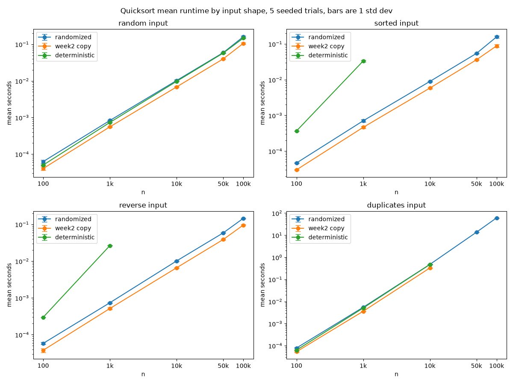
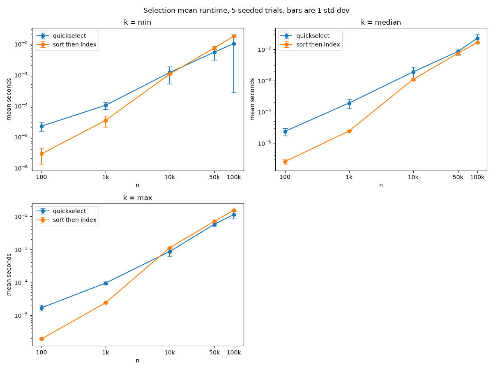
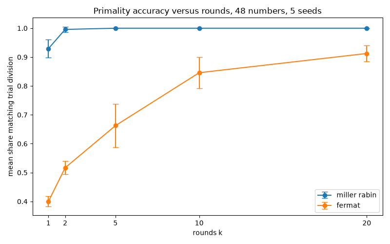
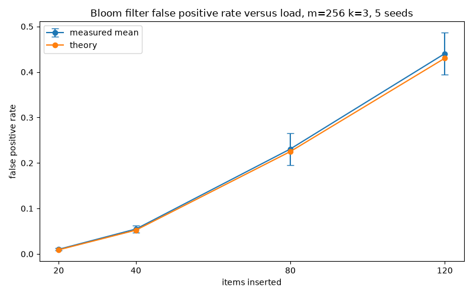
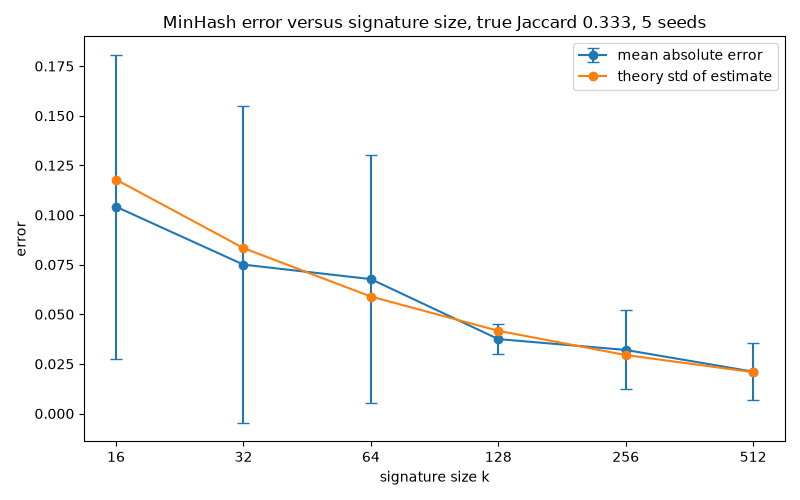

# Week 7 Randomized Algorithms Report

Omar Vasquez
Concordia University Texas MCS
CSC 5300 Advanced Algorithms
October 2026

## Executive Summary

I built five randomized algorithms in Python and tested each one against a deterministic version: randomized QuickSort, QuickSelect, the Fermat and Miller-Rabin primality tests, a Bloom filter, and MinHash. Every setup ran five times with a different seed, so I could report the spread and not just the average.

Randomness mostly did what the book said it would. On a sorted list of 1,000 items, a fixed pivot made 499,464 comparisons. The random pivot averaged 10,466. Same sorted list, almost 50 times less work. Miller-Rabin got all 48 test numbers right from 5 rounds on, while Fermat was still fooled by Carmichael numbers at 20 rounds. The Bloom filter and MinHash landed close to their formulas.

It did not fix everything, though. My partition step falls apart on lists with lots of repeated values, no matter how the pivot is picked.

## Methodology

I ran everything on Windows 11 with Python 3.14.7. The full benchmark took 91.1 seconds.

**Seeds and trials.** Each setup ran 5 trials with seeds 5300 to 5304. The input list for each size n was built once from seed 5300 + n, so every trial used the same data and only the algorithm's own random choices changed. That way the spread comes from the algorithm (plus normal timing noise), not from different inputs.

**Data.** QuickSort ran on n = 100 to 100,000 with four kinds of lists: random, sorted, reverse sorted, and duplicates. The duplicates list is each random value mod 7, so it only holds 0 to 6. QuickSelect used the random list and searched for the min, the median, and the max.

**Limits.** The fixed pivot sort is quadratic on sorted and reverse lists, so I capped it at n = 2,000 there. The duplicates list is quadratic for every version, so above n = 10,000 it ran once, randomized sort only.

**Hashing.** At first my Bloom filter and MinHash gave different answers on every run, even with the same seed, because Python's built-in hash() gets a new random salt each time Python starts. I switched to hashlib (blake2b), and now the same seed gives the same result every time.

**Metrics.** I timed each call with time.perf_counter, counted comparisons in my two QuickSort versions, and recorded the mean and sample standard deviation. Trial division was the correct answer for primality. The Bloom filter used 256 bits, 3 hashes, and 1,000 lookups of items never added. MinHash compared two word sets with a true Jaccard similarity of 0.333.

## Results

### QuickSort

| Case | Version | Mean time (s) | Mean comparisons |
|---|---|---|---|
| random, n = 100,000 | randomized | 0.160 +/- 0.009 | 2,072,193 +/- 82,189 |
| random, n = 100,000 | Week 2 copy | 0.106 +/- 0.006 | not counted |
| random, n = 100,000 | fixed pivot | 0.147 +/- 0.004 | 1,999,392 |
| sorted, n = 100,000 | randomized | 0.158 +/- 0.011 | 1,894,043 +/- 38,431 |
| sorted, n = 1,000 | randomized | 0.00071 +/- 0.00006 | 10,466 +/- 1,092 |
| sorted, n = 1,000 | fixed pivot | 0.0334 +/- 0.0019 | 499,464 |
| duplicates, n = 10,000 | randomized | 0.476 +/- 0.009 | 7,173,724 +/- 5,184 |
| duplicates, n = 100,000 | randomized (1 run) | 60.8 | 714,487,185 |

On random lists all three versions grew at the n log n rate the book predicts. The randomized comparison count only moved about 4 percent between seeds, and the time about 6 percent. The pivots change every run, but the cost stays steady.

The sorted list is where the fixed pivot broke down: 499,464 comparisons at n = 1,000, almost exactly n squared over 2, and 47 times slower than the random pivot.

The duplicates list was slow for every version. Doubling n from 50,000 (178.7 million comparisons, 13.7 s) to 100,000 (714.5 million, 60.8 s) gave 4 times the comparisons. That is what quadratic looks like.

### QuickSelect

| n = 100,000 | QuickSelect time (s) | Sort then index (s) | Recursion depth |
|---|---|---|---|
| min | 0.0101 +/- 0.0098 | 0.0174 +/- 0.0009 | 12.8 +/- 4.7 |
| median | 0.0223 +/- 0.0070 | 0.0164 +/- 0.0006 | 21.6 +/- 5.4 |
| max | 0.0113 +/- 0.0028 | 0.0153 +/- 0.0003 | 14.6 +/- 2.6 |

QuickSelect found the right value in all 75 runs. Its times spread out much more than the sort's, which makes sense because a lucky pivot throws away most of the list in one step, and an unlucky one throws away very little.

### Primality

| k | Miller-Rabin accuracy | Fermat accuracy | Carmichael numbers fooling Fermat | Bound 4^-k |
|---|---|---|---|---|
| 1 | 0.929 +/- 0.032 | 0.400 +/- 0.017 | 82 percent | 2.5e-01 |
| 5 | 1.000 +/- 0 | 0.663 +/- 0.076 | 46 percent | 9.8e-04 |
| 10 | 1.000 +/- 0 | 0.846 +/- 0.054 | 21 percent | 9.5e-07 |
| 20 | 1.000 +/- 0 | 0.913 +/- 0.027 | 12 percent | 9.1e-13 |

I tested 48 numbers: 35 Carmichael numbers, 7 primes, and 6 other composites. Every mistake was a composite called prime. For the 9 numbers above one million, trial division took 1.40e-05 s per number, and Miller-Rabin took 1.03e-05 s at k = 5 and 1.82e-05 s at k = 20.

### Bloom Filter

| Items | Measured FP rate | Theory | Load factor |
|---|---|---|---|
| 20 | 0.0102 +/- 0.0025 | 0.0091 | 0.211 |
| 40 | 0.0548 +/- 0.0075 | 0.0524 | 0.375 |
| 80 | 0.2308 +/- 0.0351 | 0.2252 | 0.607 |
| 120 | 0.4404 +/- 0.0465 | 0.4303 | 0.762 |

At every load the measured rate came within one standard deviation of the formula. As the load factor (the share of bits set to 1) climbed toward 0.76, false positives climbed with it. My tests confirm there are no false negatives.

### MinHash

| Signature k | Mean estimate | Mean absolute error | Theory std |
|---|---|---|---|
| 16 | 0.288 +/- 0.130 | 0.104 +/- 0.077 | 0.118 |
| 64 | 0.303 +/- 0.092 | 0.068 +/- 0.063 | 0.059 |
| 128 | 0.306 +/- 0.030 | 0.038 +/- 0.008 | 0.042 |
| 512 | 0.319 +/- 0.022 | 0.021 +/- 0.015 | 0.021 |

The error dropped from 0.104 to 0.021 as k went from 16 to 512 and stayed close to the theory line, sqrt(J(1 - J)/k). Using 4 times as many hashes cuts the error about in half.

## Discussion

**Las Vegas vs Monte Carlo.** Amakobe section 6.1.2 splits randomized algorithms into two kinds. Randomized QuickSort (section 6.2) and QuickSelect are Las Vegas algorithms: they always give the right answer, and only the time is random. Miller-Rabin, Fermat, the Bloom filter, and MinHash are Monte Carlo algorithms: always fast, but sometimes wrong. Miller-Rabin's chance of being fooled is at most (1/4)^k (section 6.2.3.2). Each extra round shrinks the error again, which is the amplification idea in section 6.2.5.3. My data shows it: Miller-Rabin went from 92.9 percent right at k = 1 to no mistakes from k = 5 on. Fermat has no such guarantee, because a Carmichael number passes Fermat for almost every base. The only bases that catch it are ones that share a factor with the number, so extra rounds help only when one of those happens to get picked. Miller-Rabin also checks the square roots along the way, which is why it catches Carmichael numbers that Fermat misses. That is why Fermat was still fooled 12 percent of the time at k = 20.

**Adversarial inputs.** With a fixed pivot, anyone who knows the rule can hand you the worst list, and a sorted list is the easy example. With a random pivot (section 6.2.2), no list is bad every time, and the expected cost is O(n log n) for any input.

What surprised me was the duplicates list. My Lomuto partition puts every value equal to the pivot on one side. When a big chunk of the list is the same number, it only peels off one item per step, and a random pivot cannot help because every pivot in that chunk is the same. With values mod 7, the list breaks into 7 groups of about n/7 equal numbers, and each group costs about (n/7) squared over 2 comparisons. Seven of those add up to about n squared over 14, which for n = 100,000 is the 714 million I measured. The standard fix is a three-way partition that groups the equal values together. I did not build it, so this stays a known weakness.

**Trade-offs.** My Week 2 copy took about 34 percent less time than the new randomized sort, even with the same pivot idea and partition. The new version counts every comparison and passes a seeded generator into each call, and in Python that extra work adds up. QuickSelect does less work than sorting in theory (section 6.3.3), but Python's built-in sort is written in C, so it still won at the median. QuickSelect did win for the min and max at n = 50,000 and up.

For primality, numbers around one million are small, and trial division only has to try divisors up to about 1,140, so the two came out about even. Trial division grows with the square root of n, while Miller-Rabin grows with the number of digits, so for the huge numbers used in cryptography only Miller-Rabin is practical.

**Real-world uses.** Miller-Rabin is how RSA key generation finds large primes. Bloom filters let databases and web caches skip a disk read when a key is not there, tuned with the same m, k, and load I measured (section 6.4.3). MinHash, mentioned in the Chapter 6 introduction, finds near-duplicate pages in search engines and similar items in machine learning, using the universal hashing idea in section 6.4.2.

## Conclusion

In Weeks 3 to 6 I was used to exact answers and worst-case bounds. This week the promises were about expected cost and the chance of being wrong, and the spread across my five seeds (section 6.7) showed those promises held up. The random pivot made the bad case unlikely for any list, and Miller-Rabin's mistakes were so rare that none showed up after five rounds. The biggest thing I am taking from this week is that a random choice can make the bad case rare, but I still have to test for it.
